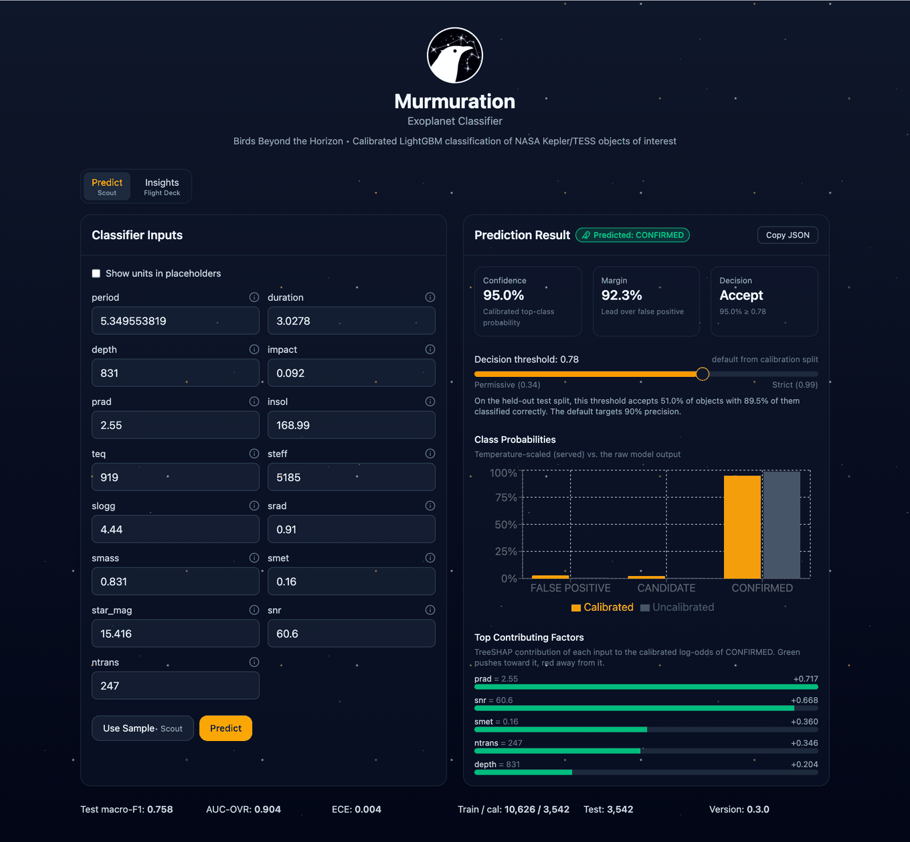
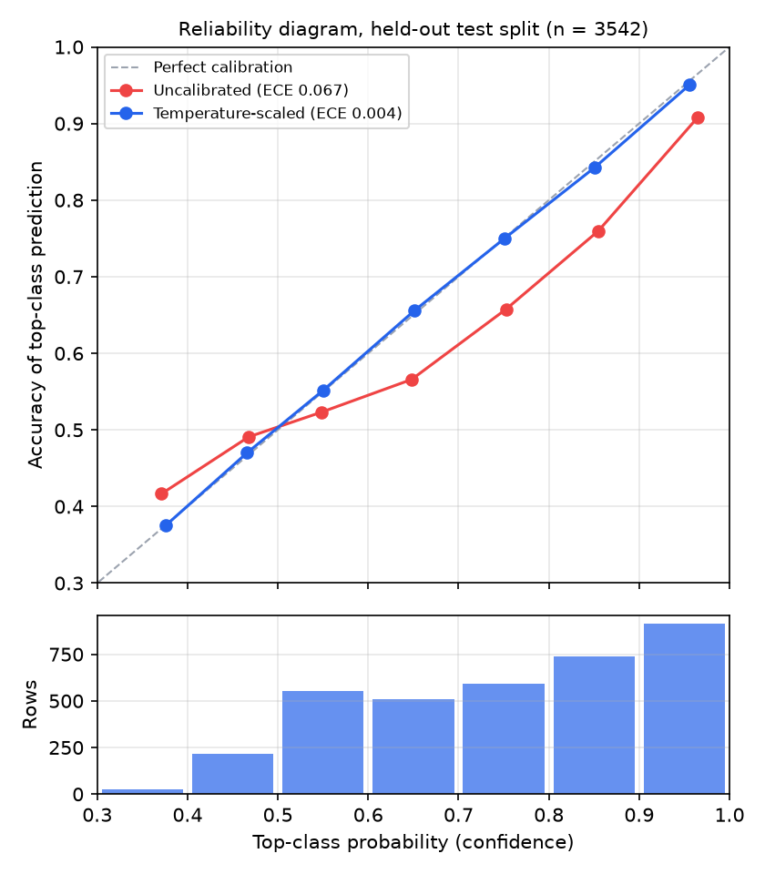
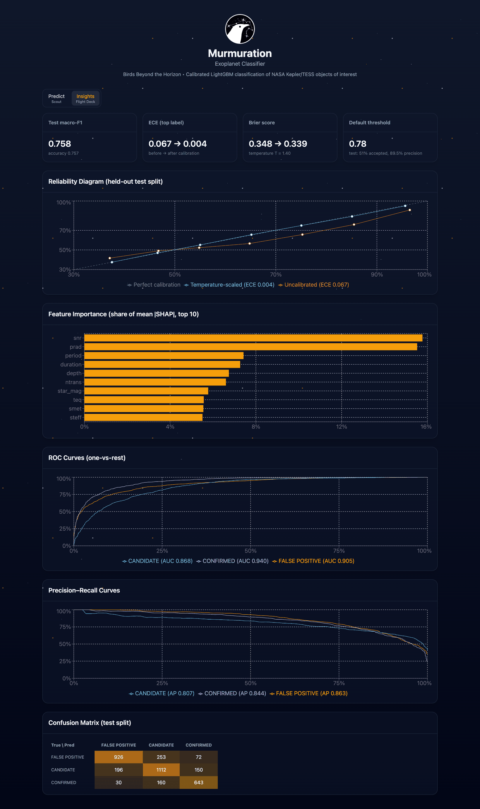

# Murmuration: exoplanet candidate triage for Kepler and TESS

Murmuration classifies Kepler and TESS objects of interest (KOIs and TOIs) as **confirmed planet**, **planet candidate** or **false positive** from 15 transit and stellar parameters. Every prediction comes with calibrated class probabilities, a per-feature attribution that explains it, and an accept-or-review decision whose threshold can be adjusted in the UI or per API request.



- **Model:** LightGBM multiclass classifier with temperature scaling fitted on a held-out calibration split
- **Backend:** FastAPI (`api/`)
- **Frontend:** Next.js 15, Tailwind CSS v4, Radix UI, Recharts (`web/`)
- **Data:** NASA Exoplanet Archive, Kepler cumulative KOI table and TESS TOI table

## Background

I built Murmuration solo for the NASA Space Apps Challenge 2025 (Sep–Oct 2025), challenge [A World Away: Hunting for Exoplanets with AI](https://www.spaceappschallenge.org/2025/challenges/a-world-away-hunting-for-exoplanets-with-ai/). The challenge asks for a model trained on NASA's open exoplanet survey data that can sort new detections. Murmuration frames that as triage: send a likely planet or a likely false positive straight through, and flag the uncertain cases for a human.

### Project history

- **October 2025 (hackathon):** data harmonization, LightGBM training with a small grid search, the FastAPI service and the web UI. That version measured calibration (a top-label reliability check) but served uncalibrated probabilities, and per-prediction SHAP was best-effort.
- **November 2026 update:** probabilities are now calibrated with temperature scaling on a held-out split and evaluated before and after; the decision threshold is chosen on calibration data instead of the test split; per-prediction attributions are exact and always returned; added a pytest suite, pinned dependencies, this README, and a retrained model on a fresh archive snapshot.

## Data

`src/data/fetch_nasa.py` queries the archive's TAP service and writes `data/raw/koi_min.csv`, `data/raw/toi_min.csv` and `data/raw/snapshot.json` (retrieval time, queries, row counts). The snapshot used for the committed model is in the repository so results can be reproduced exactly.

| | Rows | Retrieved |
|---|---:|---|
| Kepler `cumulative` (KOI) | 9,564 | 2026-11-02 16:05 UTC |
| TESS `toi` (TOI) | 8,151 | 2026-11-02 16:05 UTC |
| Labeled rows after harmonization | 17,710 | |

### Features

| Feature | Meaning | KOI column | TOI column |
|---|---|---|---|
| `period` | Orbital period (days) | `koi_period` | `pl_orbper` |
| `duration` | Transit duration (hours) | `koi_duration` | `pl_trandurh` |
| `depth` | Transit depth (ppm) | `koi_depth` | `pl_trandep` |
| `impact` | Impact parameter | `koi_impact` | not available |
| `prad` | Planet radius (Earth radii) | `koi_prad` | `pl_rade` |
| `insol` | Insolation (Earth flux) | `koi_insol` | `pl_insol` |
| `teq` | Equilibrium temperature (K) | `koi_teq` | `pl_eqt` |
| `steff` | Stellar effective temperature (K) | `koi_steff` | `st_teff` |
| `slogg` | Stellar surface gravity (log10 cm/s²) | `koi_slogg` | `st_logg` |
| `srad` | Stellar radius (solar radii) | `koi_srad` | `st_rad` |
| `smass` | Stellar mass (solar masses) | `koi_smass` | not available |
| `smet` | Stellar metallicity (dex) | `koi_smet` | not available |
| `star_mag` | Stellar magnitude | `koi_kepmag` (Kepler band) | `st_tmag` (TESS band) |
| `snr` | Transit signal-to-noise | `koi_model_snr` | not available |
| `ntrans` | Number of transits | `koi_num_transits` | not available |

Missing values stay as NaN; LightGBM learns how to route them.

### Label harmonization

`src/data/harmonize.py` maps both tables onto the three KOI classes:

| Class | Kepler (`koi_disposition`) | TESS (`tfopwg_disp`) |
|---|---|---|
| CONFIRMED | CONFIRMED | CP (confirmed planet), KP (known planet) |
| CANDIDATE | CANDIDATE | PC (planet candidate), APC (ambiguous planet candidate) |
| FALSE POSITIVE | FALSE POSITIVE | FP (false positive), FA (false alarm) |

Rows with any other or a blank disposition are dropped (5 TOIs in this snapshot). Class counts:

| | False positive | Candidate | Confirmed |
|---|---:|---:|---:|
| Kepler | 4,839 | 1,977 | 2,748 |
| TESS | 1,415 | 5,310 | 1,421 |
| Total | 6,254 | 7,287 | 4,169 |

## Method

`src/model/train.py` runs the whole pipeline:

1. **Splits.** 60% train, 20% calibration, 20% test, stratified on class × mission (seed 42): 10,626 / 3,542 / 3,542 rows. The test split is used only for the numbers reported below.
2. **Model.** LightGBM multiclass with balanced class weights and row/column subsampling. A grid over trees (300, 600), learning rate (0.05, 0.1) and leaves (31, 63) is scored by 5-fold cross-validated macro-F1 on the training split. The best setting (300 trees, learning rate 0.05, 63 leaves; CV macro-F1 0.758 ± 0.008) is refit on the full training split.
3. **Calibration.** See below.
4. **Decision threshold.** The default accepts a prediction when its top calibrated probability is at least the lowest threshold that keeps precision on the accepted set at or above 90%. It is chosen on out-of-fold calibrated probabilities from the calibration split.
5. **Evaluation and artifacts.** Everything is written to `artifacts/metrics.json`; the model is saved in LightGBM's text format (`artifacts/lightgbm_model.txt`) with the temperature in `artifacts/calibration.json`.

## Results (held-out test split, n = 3,542)

All numbers below are read from [`artifacts/metrics.json`](artifacts/metrics.json).

| Accuracy | Macro-F1 | Macro ROC AUC (one-vs-rest) |
|---:|---:|---:|
| 0.757 | 0.758 | 0.904 |

| Class | ROC AUC | Average precision |
|---|---:|---:|
| False positive | 0.905 | 0.863 |
| Candidate | 0.868 | 0.807 |
| Confirmed | 0.940 | 0.844 |

Confusion matrix (rows are the archive disposition, columns the prediction):

| | False positive | Candidate | Confirmed |
|---|---:|---:|---:|
| False positive | 926 | 253 | 72 |
| Candidate | 196 | 1,112 | 150 |
| Confirmed | 30 | 160 | 643 |

By mission:

| Mission | Rows | Accuracy | Macro-F1 | Brier | Top-label ECE |
|---|---:|---:|---:|---:|---:|
| Kepler | 1,913 | 0.789 | 0.748 | 0.293 | 0.017 |
| TESS | 1,629 | 0.719 | 0.611 | 0.393 | 0.020 |

The TESS rows are harder: the TOI table has no impact parameter, stellar mass, metallicity, model SNR or transit count, and most TESS objects are still candidates.

## Calibration

LightGBM with balanced class weights is over-confident here: on the test split, the uncalibrated predictions made with 80–90% confidence (85.5% on average) are right 76.0% of the time. Temperature scaling divides the model's logits by a single scalar T before the softmax, `p = softmax(z / T)`, with T fitted by minimizing log loss on the calibration split (T = 1.399).

Why temperature scaling:

- It had the lowest log loss and Brier score of the three standard post-hoc methods in 5-fold cross-validation **inside the calibration split** (the test split was not used to choose):

  | Method | Log loss | Brier | Top-label ECE |
  |---|---:|---:|---:|
  | Uncalibrated | 0.6122 | 0.3520 | 0.0723 |
  | Temperature scaling | **0.5847** | **0.3422** | **0.0289** |
  | Sigmoid (Platt, one-vs-rest) | 0.5892 | 0.3424 | 0.0357 |
  | Isotonic (one-vs-rest) | 0.6191 | 0.3448 | 0.0316 |

- With one parameter it cannot overfit 3,542 calibration rows, unlike isotonic regression.
- It never changes the predicted class, so accuracy, macro-F1 and the confusion matrix are identical before and after.
- It keeps attributions exact: dividing the logits by T divides each feature's contribution by T, so the explanation still adds up to the calibrated output (see below).

On the test split:

| Metric | Uncalibrated | Temperature-scaled |
|---|---:|---:|
| Log loss | 0.605 | 0.578 |
| Brier score | 0.348 | 0.339 |
| Top-label ECE | 0.067 | 0.004 |
| Classwise ECE | 0.047 | 0.018 |



Definitions: the Brier score is the multiclass form, the mean over rows of Σₖ (pₖ − 1[y = k])², which ranges from 0 to 2. ECE uses 10 equal-width bins; top-label ECE bins the highest class probability and compares it with accuracy, classwise ECE averages the one-vs-rest ECE of each class. The temperature fit is cross-checked against scikit-learn's `CalibratedClassifierCV(method="temperature")` in the tests.

## Decision threshold

A prediction is **accepted** when its top calibrated probability is at least the threshold and otherwise marked **needs review**. The default, 0.776, was chosen on the calibration split to target 90% precision on accepted predictions. On the test split it accepts 51.0% of objects (1,806 of 3,542) with 89.5% precision.

The slider in the UI moves the threshold between 0.34 and 0.99, flips the decision immediately and shows the test-split coverage and precision at the new setting; **Reset** returns to the default. The API takes the same override as `"threshold"` in the request body.


## Per-prediction attributions

`/predict` returns TreeSHAP values for every feature, computed with LightGBM's built-in `pred_contrib`. They explain the **calibrated logit of the predicted class**, `z_k / T`: a positive value pushes the object toward the predicted class, a negative value away from it, and

```
base_value + Σ contributions = logit of the predicted class
```

holds exactly for every request (the tests check this to 1e-6). The response includes `base_value` and `logit` so a client can verify it. The UI shows the five largest contributions.

## Limitations

- **Mission shortcut.** The five Kepler-only features are always missing for TESS rows, so the model can tell the missions apart and partly relies on each mission's class mix. A Kepler-style input with those fields left blank is treated like a TESS object.
- **Labels are dispositions, not ground truth.** Many candidates will later be confirmed or rejected, and the archive changes over time; the snapshot date above pins the version used.
- **Single split.** Results come from one stratified split; the cross-validation spread on the training split (±0.008 macro-F1) gives a sense of the variance.
- **Magnitudes are in different bands** for Kepler and TESS rows (`star_mag`).

## Run it locally

Tested on macOS with Python 3.12 and Node 20. On macOS, LightGBM needs OpenMP: `brew install libomp`.

### Backend (FastAPI)

```bash
git clone https://github.com/YKAwarta/murmuration.git
cd murmuration
python3.12 -m venv .venv
source .venv/bin/activate          # Windows: .venv\Scripts\activate
pip install -r requirements.txt
uvicorn api.main:app --host 127.0.0.1 --port 8081
```

The trained model is committed, so no training step is needed. Check it with `curl http://127.0.0.1:8081/health`. `api/dev.sh` starts the same server with auto-reload.

### Frontend (Next.js)

In a second terminal, with the API running:

```bash
cd web
nvm use                            # Node 20 from .nvmrc; any Node 20.x works
npm ci
npm run dev                        # http://localhost:3000
```

For a production build use `npm run build` and then `npm run start`. The app calls `/api/*`, which Next.js proxies to `http://127.0.0.1:8081` (set `API_PROXY_TARGET` to change it). `npm run lint` runs ESLint.

### Tests

```bash
pip install -r requirements-dev.txt
pytest
```

The suite runs offline in a few seconds. It covers label harmonization, the calibration code and metrics, the training pipeline end to end on synthetic data (including that the temperature is fitted on calibration rows only), every API endpoint, and the shipped model in `artifacts/`.

### Retrain

```bash
python -m src.model.train          # uses data/raw/; about 5 minutes on a laptop
```

This rewrites `artifacts/` and `docs/reliability_diagram.png`; with the committed snapshot it reproduces the numbers above. To train on the current archive instead, run `python -m src.data.fetch_nasa` first.

## API

| Method | Path | Returns |
|---|---|---|
| GET | `/health` | `{"ok": true, "version": ...}` |
| GET | `/metadata` | features, labels, headline test metrics, calibration temperature, default threshold |
| GET | `/metrics_full` | the full `metrics.json` (curves, reliability bins, confusion matrix, importances) |
| GET | `/feature_info` | unit and description for each feature |
| GET | `/echo-sample?index=i` | one of six held-out test rows (one per mission and class) with its true label |
| POST | `/predict` | label, calibrated and raw probabilities, decision, attributions |
| POST | `/batch_predict` | label, calibrated probabilities and decision for a list of rows |

```bash
curl -s http://127.0.0.1:8081/predict -H 'Content-Type: application/json' \
  -d '{"features": {"period": 5.35, "duration": 3.03, "depth": 831, "impact": 0.09, "prad": 2.55,
                    "insol": 169, "teq": 919, "steff": 5185, "slogg": 4.44, "srad": 0.91,
                    "smass": 0.83, "smet": 0.16, "star_mag": 15.4, "snr": 60.6, "ntrans": 247},
       "threshold": 0.9}'
```

Feature values must be numbers; missing ones can be omitted, `null` or `""`. Unknown feature names and non-numeric values return HTTP 422. Set `MURMURATION_INFER_LOG=/path/to/log.csv` to append each `/predict` request and result to a CSV (off by default).

## Repository layout

```
api/            FastAPI app (main.py), request schema, dev.sh
src/data/       fetch_nasa.py (archive download), harmonize.py (label mapping, feature table)
src/model/      train.py (pipeline), calibration.py (temperature scaling, metrics), predictor.py (inference + attributions)
artifacts/      trained model, calibration, metrics.json, sample inputs
data/raw/       archive snapshot used for the committed model
docs/           reliability diagram and UI screenshots
tests/          pytest suite
web/            Next.js app
```



## Acknowledgments

This research has made use of the NASA Exoplanet Archive, which is operated by the California Institute of Technology, under contract with the National Aeronautics and Space Administration under the Exoplanet Exploration Program.

## License

Code is released under the [MIT License](LICENSE). The files in `data/raw/` are extracts of public NASA Exoplanet Archive tables.
